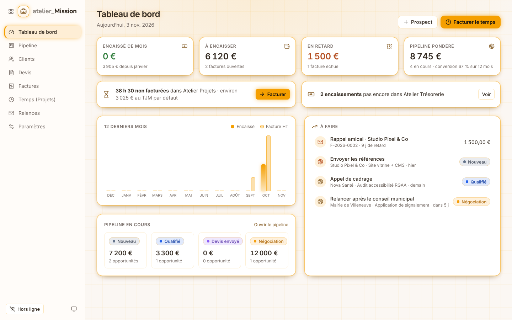
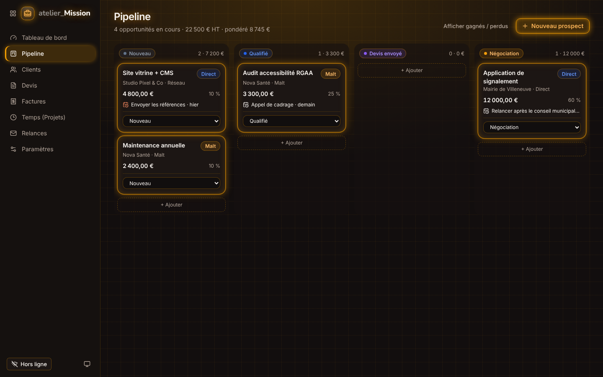
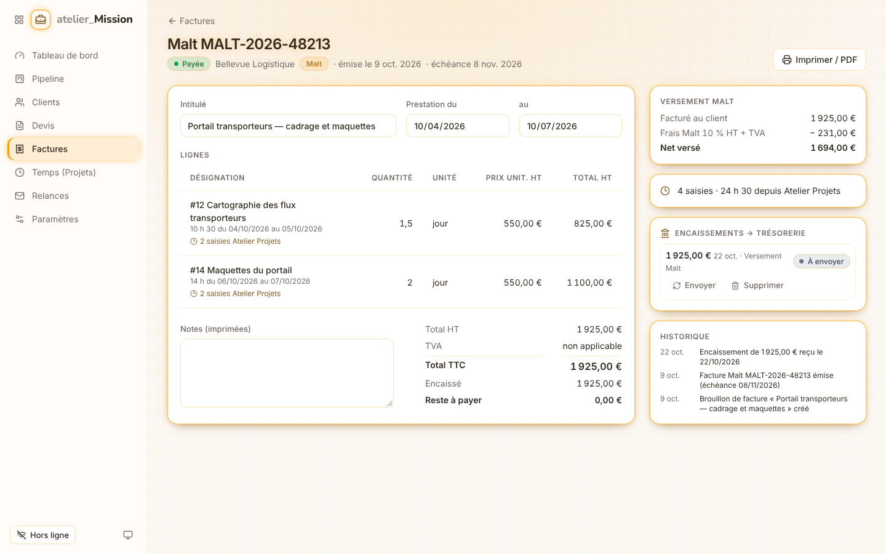
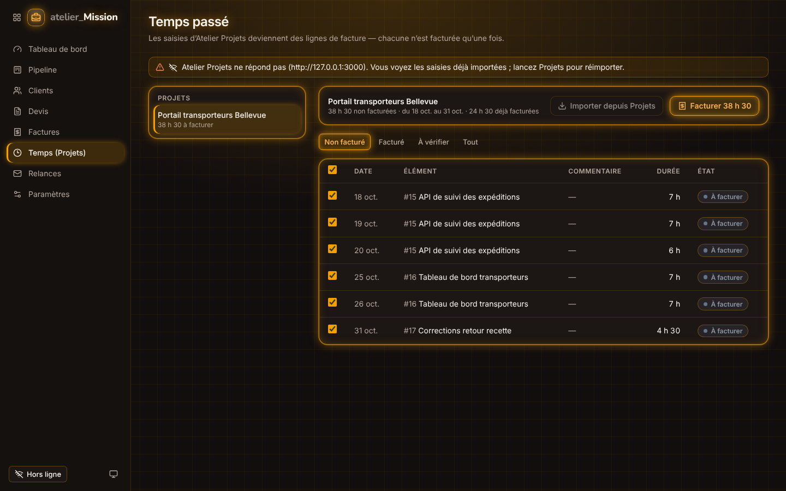

# atelier_Mission

**Mini-CRM local pour freelance** : prospects Malt et clients directs, devis, factures, encaissements et relances.
C’est l’app de la Suite Atelier qui en relie le plus d’autres :

```
            ┌──────────────── Atelier Projets ────────────────┐
            │  temps saisi (atelier-table/1, 127.0.0.1:3000)  │
            └───────────────────────┬─────────────────────────┘
                                    ▼  import + « Facturer le temps »
 Malt / contact ─▶  Pipeline ─▶  Devis ─▶  Facture ─▶  Encaissement ─▶  Atelier Trésorerie
   (prospect)      (kanban)    (D-2026-…) (F-2026-…)        │           (opération revenu
                                               │            │            + frais Malt, :5050)
                                               ▼            ▼
                                       Relances J+3/15/30   Événements atelier-node/1
                                       par Brevo (en ligne)  (Atelier Nexus)
```

| | |
|---|---|
|  |  |
|  |  |

---

## Ce que fait l’application

| Écran | À quoi il sert |
|---|---|
| **Tableau de bord** | Encaissé du mois / de l’année, à encaisser, en retard, pipeline pondéré, conversion sur 12 mois, temps non facturé, graphique 12 mois, et la liste « À faire » (relances dues, factures échues, prochaines actions, devis qui expirent). |
| **Pipeline** | Kanban *Nouveau → Qualifié → Devis envoyé → Négociation → Gagné / Perdu*, glisser-déposer (ou menu « Déplacer vers » au clavier / sur mobile). Montant direct ou **TJM × jours**, probabilité par étape, prochaine action datée, lien vers la mission Malt, projet Atelier Projets lié. |
| **Clients** | Fiche de facturation (adresse, SIREN, e-mail des relances), canal **Malt** ou **Direct**, frais Malt propres au client, encours et fil d’activité. |
| **Devis** | Numérotation `D-AAAA-NNNN`, lignes (jour, heure, unité, forfait), TVA par taux ou franchise, *Envoyé → Accepté / Refusé* (l’opportunité suit), nouvelle version, impression PDF, **transformation en facture**. |
| **Factures** | Brouillon libre, puis **émission** : numéro légal chronologique `F-AAAA-NNNN`, coordonnées figées, échéance, relances planifiées. Une facture émise ne se modifie plus : **avoir** `A-AAAA-NNNN`. Encaissements partiels, statut *en retard* calculé, impression avec mentions légales. |
| **Temps (Projets)** | Import des saisies d’un projet d’Atelier Projets, sélection, aperçu des lignes (jours au TJM ou heures, regroupées par élément / projet / saisie), création du brouillon. **Une saisie n’est jamais facturée deux fois** ; une saisie modifiée ou supprimée dans Projets après facturation est signalée. |
| **Relances** | File *À envoyer / À venir / Historique*, aperçu de l’e-mail, envoi par **Brevo**, report, annulation. Ton croissant (rappel amical → relance avec pénalités → dernière relance avant mise en demeure). |
| **Paramètres** | Identité et mentions légales, TJM / heures par jour, délais, préfixes, frais Malt, calendrier des relances, connexions (Projets, Trésorerie, Brevo). |

### Malt, concrètement
Sur Malt, c’est **Malt qui émet la facture** au nom du freelance (mandat de facturation), encaisse le client et
verse le net après ses frais de service. Atelier Mission en tient compte :

- un client **Malt** n’a ni numéro de facture propre (on saisit le numéro de la facture Malt) ni relance Brevo ;
- les **frais de service** sont un taux HT par client (souvent 10 %, puis 5 % après six mois avec le même client — Malt a changé ses conditions plusieurs fois en 2026 : vérifiez sur help.malt.com) + TVA 20 %, figés sur chaque facture ;
- à l’encaissement, **Trésorerie reçoit deux opérations** : le montant facturé en revenu et les frais Malt TTC en dépense. Le net correspond au virement reçu, et le chiffre d’affaires reste le montant brut.

---

## Démarrer

Prérequis : **Node.js 22.12+ ou 24** (`.nvmrc`), npm 10+.

```bash
npm install
npm run setup          # crée la base SQLite (backend/data/) + données de démonstration fictives
npm run dev            # API http://127.0.0.1:3001 · interface http://127.0.0.1:5176
```

`npm run app` compile l’interface et la sert en mode aperçu (`http://127.0.0.1:4176`).
Pour partir d’une base vide : `npm run db:migrate --workspace=@atelier-mission/backend` sans `db:seed`.

### Brancher les autres apps
1. **Atelier Projets** lancé (`http://127.0.0.1:3000`) → écran *Temps* › *Importer depuis Projets*.
2. **Atelier Trésorerie** lancé (`http://127.0.0.1:5050`) → *Paramètres › Connexions* : choisir le compte bancaire et les catégories (encaissements, frais Malt).
3. **Brevo** : copier `backend/.env.example` en `backend/.env`, renseigner `BREVO_API_KEY` (Brevo › SMTP & API › Clés API), relancer l’API, puis choisir l’expéditeur vérifié dans *Paramètres › Connexions*. Les relances ne partent qu’en mode **En ligne** (interrupteur en bas de la barre latérale).

---

## Architecture (monorepo npm)

```
atelier_mission/
├── design-system/   Jetons et thèmes de la Suite (copies d'Atelier Projets) + signature ambre + couleurs métier
├── backend/         Fastify 5 · TypeScript · Drizzle ORM · SQLite (better-sqlite3)
│   ├── src/domain/        règles pures : montants, TVA, numérotation, Malt, temps → lignes, relances
│   ├── src/services/      logique métier + SQL, événements émis dans la transaction de l'écriture
│   ├── src/integrations/  clients Projets, Trésorerie (bouclage uniquement) et Brevo
│   ├── src/routes/        routes minces validées par TypeBox ; /api/atelier/* = nœud de la suite
│   ├── src/print/         facture / devis / avoir en HTML imprimable (PDF par le navigateur)
│   ├── drizzle/           migrations SQL générées (npm run db:generate)
│   └── test/              56 tests (node:test) : domaine, parcours complet, temps, relances, sécurité, contrats HTTP
├── frontend/        React 19 · Vite 8 · Tailwind CSS 4 · Zustand · Lucide
└── docs/            UX (parcours), UI (écrans, captures), intégrations, conformité, décisions (ADR)
```

| Port | Service |
|---|---|
| `127.0.0.1:3001` | API d’Atelier Mission |
| `127.0.0.1:5176` / `4176` | Interface (dev / aperçu), `/api` relayé vers 3001 |
| `127.0.0.1:3000` | Atelier Projets (lu) |
| `127.0.0.1:5050` | Atelier Trésorerie (écrit) |

Règles complètes pour contribuer (humain ou IA) : [`CLAUDE.md`](CLAUDE.md).

## Documentation

- [docs/ux/parcours.md](docs/ux/parcours.md) — personas, parcours clés, principes UX
- [docs/ui/ecrans.md](docs/ui/ecrans.md) — écrans, composants, charte « néon monochrome » ambre
- [docs/INTEGRATIONS.md](docs/INTEGRATIONS.md) — contrats avec Projets, Trésorerie, Brevo et Nexus (`atelier-node/1`)
- [docs/CONFORMITE.md](docs/CONFORMITE.md) — mentions légales, numérotation, facturation électronique 2026-2027
- [docs/adr/](docs/adr/) — décisions d’architecture

## Vérifier

```bash
npm test         # backend (56 tests) + frontend
npm run check    # typage + conformité du design system
npm run build
```

## Confidentialité
Local d’abord : l’API n’écoute que sur `127.0.0.1` et refuse les hôtes et origines étrangers (DNS rebinding, CSRF).
Projets et Trésorerie ne sont joints qu’en bouclage. **Brevo est le seul flux sortant**, désactivé hors ligne
(défaut) ; la clé API reste dans `backend/.env`, jamais en base ni dans les réponses de l’API.
