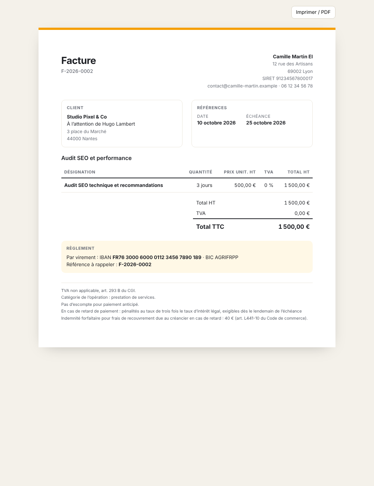

# UI — écrans, composants et charte

## Charte
Atelier Mission suit la **charte v2 « Linear »** de la Suite Atelier (`Atelier_Deploy/DESIGN.md`, `docs/SUITE.md` §1.7
d'Atelier Projets) : structure neutre gris froid commune à la suite, en clair comme en sombre, dense et plate au repos
(traits de 1 px, aucune ombre hors menus et dialogues). La signature de Mission, **l'ambre `#b55d00`**
(`data-atelier-app="mission"`, déclarée dans la marque commune), ne sert qu'à l'accent : bouton principal plein,
sélection, focus, liens et icône de l'app (glyphe Lucide `receipt`).

Coquille : barre latérale de 232 px (marque, sélecteur de la suite, rubriques, puis interrupteur Hors ligne / En ligne
et thème Système / Clair / Sombre), barre haute de 44 px avec le titre de l'écran (fil d'Ariane sur une fiche) ; sur
téléphone, bandeau en haut et rubriques en pastilles défilantes. Le thème est la préférence commune de la suite
(`design-system/brand/atelier-theme.js`).

**Les couleurs qui portent un sens ne prennent jamais la signature** : elles réutilisent les 8 statuts officiels de la
suite (`design-system/components/mission.css`). Un badge est neutre, seule sa pastille est colorée ; **factures et
relances ne sont colorées que lorsqu'elles demandent l'attention** (en retard, relance due, échec) — pastille vide pour un
brouillon, une relance prévue ou une annulation.

| Attribut | Valeurs → statut officiel |
|---|---|
| `data-stage` | NEW → open · QUALIFIED → progress · PROPOSAL → review · NEGOTIATION → hold · WON → closed · LOST → rejected |
| `data-quote` | DRAFT → open · SENT → review · ACCEPTED → closed · DECLINED → rejected · EXPIRED → hold |
| `data-invoice` | DRAFT, ISSUED, PARTIALLY_PAID, PAID, CANCELLED → open (neutre) · **OVERDUE → blocked** |
| `data-reminder` | PLANNED, SENT, CANCELLED → open (neutre) · **DUE → hold** · **FAILED → rejected** |
| `data-money` | in → closed · out → rejected · late → blocked |
| `data-channel` | MALT → signature · DIRECT → progress |

Typographie : Inter variable embarquée (`design-system/brand/`, aucune requête réseau), 13 px sur ordinateur, 14 px sur
téléphone. Chiffres tabulaires (`.ms-num`, tableaux) pour tous les montants, alignés à droite.

## Écrans

| Écran | Route | Composition |
|---|---|---|
| Tableau de bord | `#/` | 4 indicateurs · bandeaux d'action (temps non facturé, encaissements à synchroniser) · graphique 12 mois (encaissé / facturé HT) · pipeline par étape · liste « À faire » |
| Pipeline | `#/pipeline` | colonnes par étape (somme et nombre), cartes glissables, menu « Déplacer vers », fiche opportunité en fenêtre |
| Clients | `#/clients`, `#/clients/:id` | tableau (canal, opportunités, facturé, à encaisser) ; fiche : coordonnées, activité, opportunités, devis, factures |
| Devis | `#/devis`, `#/devis/:id` | filtres par statut ; éditeur de lignes, totaux, actions de statut, impression |
| Factures | `#/factures`, `#/factures/:id` | filtres statut + canal + recherche ; fiche : lignes, totaux, mentions, colonne latérale (versement Malt, temps lié, encaissements → Trésorerie, relances, historique) |
| Temps | `#/temps` | projets de Projets (temps à facturer), saisies filtrables, sélection, fenêtre « Facturer » avec aperçu |
| Relances | `#/relances` | onglets À envoyer / À venir / Historique, aperçu e-mail (iframe sans script), report, annulation |
| Paramètres | `#/parametres?onglet=` | Entreprise · Facturation & Malt · Relances · Connexions |

Captures : [`captures/`](captures/) (générées avec Playwright sur les données de démonstration).

## Composants (frontend/src/components)
- `ui.tsx` — `Button` (`ds-btn`, variantes primary / ghost / danger), `Card`, `Kpi`, badges métier (`StageBadge`,
  `QuoteBadge`, `InvoiceBadge`, `ChannelBadge`, `ToneBadge`), `Money`, `Field` / `Input` / `Select` / `TextArea`,
  `Modal` (`<dialog>` natif), `Notice`, `EmptyState`, `Toasts`.
- `LinesEditor.tsx` — lignes de devis / facture : saisie à la française (« 2,5 », « 550 »), réordonnancement, lien
  vers les saisies de temps, totaux indicatifs (le backend fait foi).
- `OpportunityForm.tsx` — fiche opportunité (client existant ou nouveau, TJM × jours, projet Projets, lien Malt).
- `shell.tsx` — barre latérale, marque, sélecteur « Suite Atelier » (santé des apps), interrupteur Hors ligne / En ligne, thème Clair / Sombre / Système.

## Accessibilité
- Contrastes : textes de couleur via `--kind-ink` / `--accent-ink` (signature assombrie en clair, éclaircie en sombre).
- Statut jamais porté par la couleur seule : chaque badge a son libellé.
- Focus visible (`--focus-ring`), fenêtres modales natives, `aria-pressed` sur les filtres, `aria-current` sur la navigation.
- Glisser-déposer doublé d'un `<select>` « Déplacer vers » sur chaque carte.
